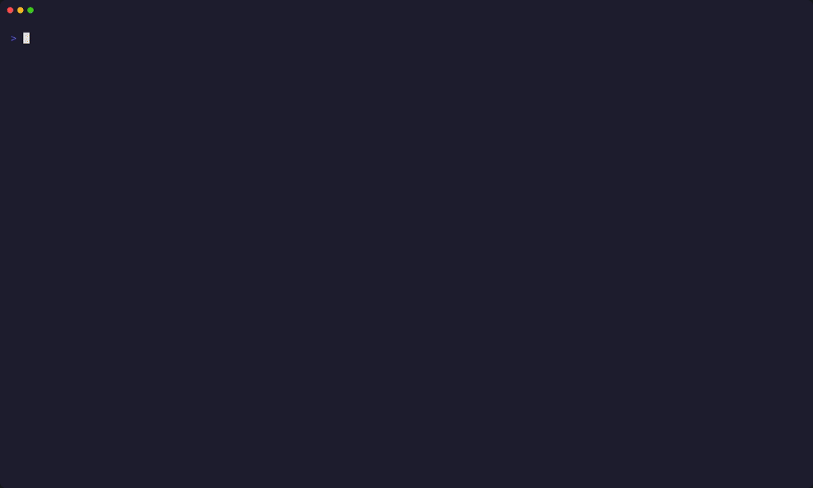

# docktop

A fast, lightweight, and modern Terminal UI (TUI) for Docker, built with Go.

Manage and monitor your Docker with keyboard-driven ease.



---


## Installation

### Option 1: Download Pre-built Package or Binary
Download the latest package or binary for your operating system (Linux, macOS, Windows) from the [Releases](https://github.com/xoaiPro235/docktop/releases) page.

```bash
# Debian / Ubuntu (.deb)
sudo dpkg -i docktop_*_linux_amd64.deb

# Fedora / RHEL (.rpm)
sudo rpm -i docktop_*_linux_amd64.rpm

# Or extract standalone binary (Linux / macOS)
tar -xzf docktop_*_linux_amd64.tar.gz
sudo mv docktop /usr/local/bin/

# Windows
# Extract the .zip archive and add docktop.exe to your PATH
```

### Option 2: Using `go install`
```bash
go install github.com/xoaiPro235/docktop/cmd/docktop@latest
```

### Option 3: Build from Source
```bash
git clone https://github.com/xoaiPro235/docktop.git
cd docktop
make build
./docktop
```

---

## Configuration & Themes

`docktop` reads its configuration from the standard OS configuration directory:
- **Linux/Unix:** `~/.config/docktop/config.yaml`
- **macOS:** `~/Library/Application Support/docktop/config.yaml`
- **Windows:** `%APPDATA%\docktop\config.yaml`

If the file does not exist, `docktop` automatically creates one with default settings upon first launch.

### Example `config.yaml`:

```yaml
# docktop configuration file
# Default locations:
#   - Linux/Unix : ~/.config/docktop/config.yaml
#   - macOS      : ~/Library/Application Support/docktop/config.yaml
#   - Windows    : %APPDATA%\docktop\config.yaml

# UI Theme:
# Available presets:
#   - tokyo-night : Default vibrant Tokyo Night / Neon aesthetic
#   - terminal    : Adaptive 16 ANSI colors (automatically matches your terminal emulator theme: Kitty, Alacritty, iTerm2, WezTerm)
#   - dracula     : Classic Dracula dark theme
#   - catppuccin  : Soothing Catppuccin Mocha theme
#   - nord        : Arctic, north-bluish palette
theme: "terminal"

# Docker Host:
# Optional Docker daemon endpoint or remote socket.
# If omitted or left empty, docktop falls back to the DOCKER_HOST environment variable,
# or the standard OS Docker daemon socket / named pipe.
# Examples:
#   host: "unix:///var/run/docker.sock"
#   host: "unix:///run/user/1000/docker.sock" (Rootless Docker)
#   host: "npipe:////./pipe/dockerDesktopLinuxEngine" (Windows Docker Desktop)
#   host: "ssh://user@remote-vps:22"
#   host: "tcp://192.168.1.100:2376"
# host: ""
```

> **Tip:** Setting `theme: "terminal"` will make `docktop` automatically inherit whatever colors your terminal emulator (Kitty, Alacritty, iTerm2, WezTerm) is configured with!
>
> **Remote Docker / SSH:** You can specify a remote Docker endpoint via `-H / --host`, the `host` config option, or `DOCKER_HOST`:
> ```bash
> docktop -H ssh://user@remote-vps
> ```
---
## 🙏 Acknowledgements

`docktop` is inspired by and learns from amazing open-source projects:

- **[btop](https://github.com/aristocratos/btop)** by aristocratos – Visual inspiration for Braille graph resource monitoring and mirrored layouts.
- **[lazydocker](https://github.com/jesseduffield/lazydocker)** by Jesse Duffield – Workflow inspiration for container lifecycle management and compose tree structure.
- **[Charmbracelet (Bubble Tea & Lipgloss)](https://github.com/charmbracelet)** – The wonderful TUI framework and styling toolkit powering this project.
- Container statistics calculation logic adapted from [docker/cli](https://github.com/docker/cli) (Apache-2.0 License).
---

## 📄 License

This project is licensed under the [MIT License](LICENSE).
