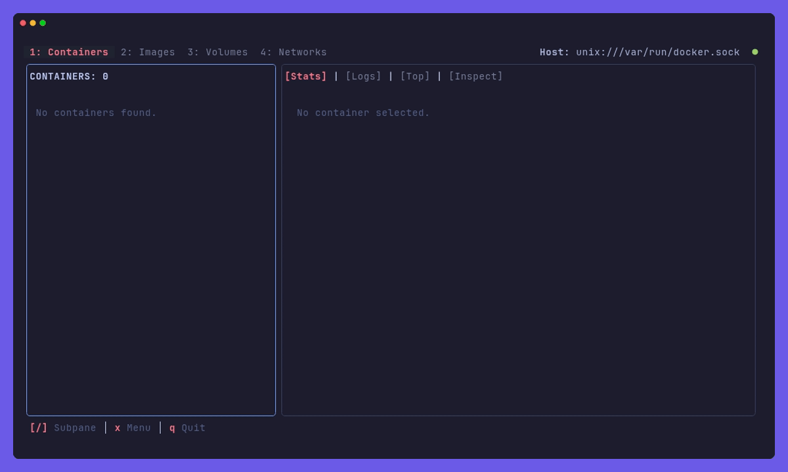

# docktop

A fast, lightweight, and modern Terminal UI (TUI) for managing Docker, built with Go.

Manage and monitor your Docker containers, images, volumes, and networks with keyboard-driven ease.



---

## Table of Contents

- [Installation](#installation)
  - [Linux](#linux)
  - [macOS](#macos)
  - [Windows](#windows)
  - [Go Install](#go-install)
  - [Build from Source](#build-from-source)
- [Keybindings](#keybindings)
- [Configuration](#configuration)
- [Remote Docker (-H)](#remote-docker--h)
- [🙏 Acknowledgements](#acknowledgements)
- [📄 License](#license)

---

## Installation

### Linux

#### Debian / Ubuntu (`.deb`)
```bash
sudo dpkg -i docktop_*_linux_amd64.deb
```

#### Fedora / RHEL (`.rpm`)
```bash
sudo rpm -i docktop_*_linux_amd64.rpm
```

#### Standalone Binary
Download the pre-compiled archive from [Releases](https://github.com/xoaiPro235/docktop/releases) and extract:
```bash
tar -xzf docktop_*_linux_amd64.tar.gz
sudo mv docktop /usr/local/bin/
```

### macOS

Install via [Homebrew](https://brew.sh/):

```bash
brew install xoaiPro235/tap/docktop
```

Or download the pre-compiled `.tar.gz` binary from the [Releases](https://github.com/xoaiPro235/docktop/releases) page.

### Windows

#### WinGet
```powershell
winget install xoaiPro235.docktop
```

#### Scoop
```powershell
scoop bucket add xoaipro235 https://github.com/xoaiPro235/scoop-bucket
scoop install docktop
```

#### Manual
Download the `.zip` archive from [Releases](https://github.com/xoaiPro235/docktop/releases) and add `docktop.exe` to your `PATH`.

### Go Install

```bash
go install github.com/xoaiPro235/docktop/cmd/docktop@latest
```

### Build from Source

```bash
git clone https://github.com/xoaiPro235/docktop.git
cd docktop
make build
./docktop
```

---

## Keybindings

| Key | Description |
| :--- | :--- |
| `1` - `4` | Switch tabs: Containers (`1`), Images (`2`), Volumes (`3`), Networks (`4`) |
| `Tab` | Toggle focus between Tree and Detail pane |
| `z` | Zoom / unzoom active pane to full screen |
| `x` | Open Action Menu (built-in actions & custom commands) |
| `/` | Activate search filter (Press `Esc` to clear) |
| `o` | Open published container port in default browser |
| `s` | Start / Stop selected container or compose service |
| `r` | Restart selected container or compose service |
| `p` | Pause / Unpause container |
| `d` / `P` | Remove resource (`d`) or Prune unused resources (`P`) |
| `q` / `Ctrl+C` | Quit docktop |

---

## Configuration

`docktop` reads its configuration from the standard OS configuration directory:

- **Linux/Unix:** `~/.config/docktop/config.yaml`
- **macOS:** `~/Library/Application Support/docktop/config.yaml`
- **Windows:** `%APPDATA%\docktop\config.yaml`

If the file does not exist, `docktop` automatically generates one with default settings upon first launch.

> **Note:** Ensure your terminal has a [Nerd Font](https://www.nerdfonts.com/) installed (e.g. JetBrainsMono, FiraCode) to display container and service icons properly.

<details>
<summary><b>Click to expand full example <code>config.yaml</code></b></summary>

```yaml
# docktop configuration file

# UI Theme:
# Available presets:
#   - tokyo-night : Default vibrant Tokyo Night.
#   - terminal    : Adaptive 16 ANSI colors.
#   - dracula     : Classic Dracula dark theme.
#   - catppuccin  : Catppuccin Mocha theme.
#   - nord        : Arctic, north-bluish palette.
#   - one-dark    : Iconic OneDark theme.
#   - gruvbox     : Gruvbox dark theme.
#   - everforest  : Everforest dark theme.
#   - rose-pine   : Rosé Pine dark theme.
theme: "terminal"

# Docker Host (optional daemon socket or remote endpoint):
# host: "unix:///var/run/docker.sock"
# host: "npipe:////./pipe/dockerDesktopLinuxEngine"
# host: "ssh://user@remote-vps:22"

# Container Icons (Nerd Font mappings):
# icons:
#   postgres: "󰆼"
#   redis: "󰟆"
#   mysql: "󰆚"
#   nginx: "󱏿"
#   node: "󰎙"
#   python: "󰌠"
#   default: "󰡨"

# Custom Commands (Shown in Action Menu 'x'):
# Template variables:
#   Containers: {{ .ID }}, {{ .Name }}, {{ .Image }}
#   Images:     {{ .ID }}, {{ .Repository }}, {{ .Tag }}
#   Volumes:    {{ .Name }}
#   Networks:   {{ .ID }}, {{ .Name }}
# customCommands:
#   containers:
#     - name: "Bash Shell"
#       command: "docker exec -it {{ .ID }} bash"
#     - name: "Inspect Container JSON"
#       command: "docker inspect {{ .ID }}"
#       pause: true
#   images:
#     - name: "Image History"
#       command: "docker history {{ .ID }}"
#       pause: true
#   volumes:
#     - name: "Browse Files (Busybox)"
#       command: "docker run --rm -it -v {{ .Name }}:/v busybox ls -la /v"
#       pause: true
#   networks:
#     - name: "Inspect Network"
#       command: "docker network inspect {{ .Name }}"
#       pause: true
```

</details>

---

## Remote Docker (-H)

By default, `docktop` connects to your local Docker daemon socket (`/var/run/docker.sock` on Linux/macOS or named pipe on Windows).

To connect to a remote Docker host or custom socket, use the `-H` (or `--host`) flag:

```bash
# Connect securely to a remote host via SSH
docktop -H ssh://user@remote-server

# Connect to a Rootless Docker socket
docktop -H unix:///run/user/1000/docker.sock
```

You can also specify a default host in `config.yaml` or via the standard `DOCKER_HOST` environment variable.

---

<a id="acknowledgements"></a>
## 🙏 Acknowledgements

`docktop` is inspired by and learns from amazing open-source projects:

- **[btop](https://github.com/aristocratos/btop)** by aristocratos – Visual inspiration for Braille graph resource monitoring and mirrored layouts.
- **[lazydocker](https://github.com/jesseduffield/lazydocker)** by Jesse Duffield – Workflow inspiration for container lifecycle management and compose tree structure.
- **[Charmbracelet (Bubble Tea & Lipgloss)](https://github.com/charmbracelet)** – The wonderful TUI framework and styling toolkit powering this project.
- **[docker/cli](https://github.com/docker/cli)** - Container statistics calculation logic (Apache-2.0 License).

---

<a id="license"></a>
## 📄 License

This project is licensed under the [MIT License](LICENSE).
